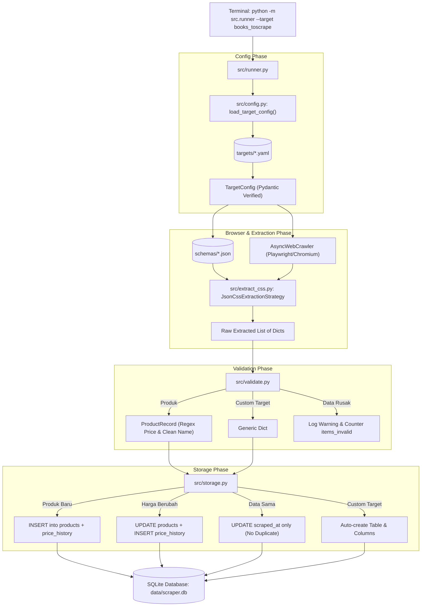
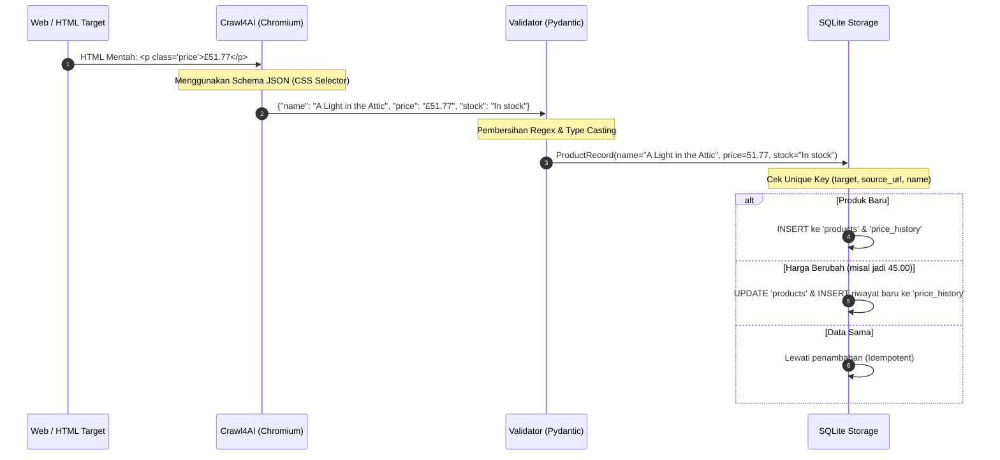

# 🕷️ Panduan Komprehensif Arsitektur & Bedah Codebase Scraper (Crawl4AI)

> **Dokumen Panduan & Materi Video**: Dibuat khusus untuk memahami alur kerja, dataflow, arsitektur *config-driven*, dan konsep di balik codebase scraper Crawl4AI agar siap dipresentasikan dalam video edukasi tingkat tinggi.

---

## 📑 Daftar Isi
1. [Filosofi Arsitektur: Mengapa Codebase Ini Spesial?](#1-filosofi-arsitektur-mengapa-codebase-ini-spesial)
2. [Peta Struktur File & Direktori](#2-peta-struktur-file--direktori)
3. [Bedah File demi File (Deep Dive)](#3-bedah-file-demi-file-deep-dive)
   - [A. targets/*.yaml (Definisi Target)](#a-targetsyaml-definisi-target)
   - [B. schemas/*.json (Deklarasi Selektor)](#b-schemasjson-deklarasi-selektor)
   - [C. src/config.py (Validasi Konfigurasi)](#c-srcconfigpy-validasi-konfigurasi)
   - [D. src/extract_css.py (Jantung Crawl4AI)](#d-srcextract_csspy-jantung-crawl4ai)
   - [E. src/validate.py (Pembersihan & Validasi Data)](#e-srcvalidatepy-pembersihan--validasi-data)
   - [F. src/storage.py (Database, Idempotensi & Riwayat Harga)](#f-srcstoragepy-database-idempotensi--riwayat-harga)
   - [G. src/runner.py (Konduktor & CLI Pipeline)](#g-srcrunnerpy-konduktor--cli-pipeline)
4. [Diagram Workflow & Dataflow](#4-diagram-workflow--dataflow)
5. [Fitur Unggulan "Engineering-Grade" untuk Highlight Video](#5-fitur-unggulan-engineering-grade-untuk-highlight-video)
6. [Blueprint Struktur Konten Video (Script Outline)](#6-blueprint-struktur-konten-video-script-outline)
7. [Cheatsheet Perintah Demo & Live Query Database](#7-cheatsheet-perintah-demo--live-query-database)

---

## 1. Filosofi Arsitektur: Mengapa Codebase Ini Spesial?

Kebanyakan tutorial web scraping pemula di YouTube mengajarkan cara seperti ini:
```python
# ❌ Pola Pemula (Spaghetti & Hardcoded)
response = requests.get("https://contoh-toko.com")
soup = BeautifulSoup(response.text, "html.parser")
for item in soup.find_all("div", class_="card"):
    print(item.find("h2").text)
```
**Kelemahan pola pemula:**
1. **Terkunci ke 1 website**: Mau scrape web kedua? Harus buat file python baru lagi atau copy-paste kode.
2. **Mudah hancur**: Bila web menggunakan JavaScript/SPA (React/Vue), `requests` gagal karena tidak mengeksekusi JS.
3. **Kotor & Duplikat**: Kalau dijalankan 2x, data masuk dobel ke database.
4. **Sulit diuji**: Pengujian butuh koneksi internet hidup setiap saat.

### Solusi Codebase Ini: *Config-Driven Architecture* (Satu Mesin, Banyak Target)
Codebase Anda mengadopsi standar software engineering tingkat lanjut:
- **`src/` adalah Mesin Universal (Engine)**: Kode di `src/` sama sekali **tidak mengenal nama website**, URL, ataupun class CSS tertentu.
- **Konfigurasi Dipisah Total**:
  - Apa yang mau di-scrape dan batas halamannya? Ditulis di `targets/<nama>.yaml`.
  - Di mana letak elemen HTML-nya? Dideklarasikan di `schemas/<nama>.json`.
- **Ekstraksi Modern dengan Crawl4AI**: Memanfaatkan headless browser (Playwright/Chromium) yang mengeksekusi JavaScript secara asinkron (`asyncio`).
- **Data Validation & Sanitization**: Menggunakan Pydantic untuk parsing otomatis (misal: `"£51.77"` diubah jadi float `51.77`).
- **Smart Idempotent Storage**: Menjalankan scraper 100 kali tidak akan menggandakan data. Jika harga berubah, sistem otomatis mencatat riwayat perubahannya (*price history tracking*).

---

## 2. Peta Struktur File & Direktori

```text
Crawl4AI/
├── targets/                      # 📁 Definisi website target (YAML)
│   ├── _template.yaml            # Blueprint untuk target baru (diabaikan loader)
│   ├── books_toscrape.yaml       # Target 1: Toko Buku
│   ├── ecommerce_demo.yaml       # Target 2: Katalog Laptop
│   └── job.yaml                  # Target 3: Lowongan Kerja (Skema Dinamis)
│
├── schemas/                      # 📁 Skema CSS Selector (JSON)
│   ├── books_toscrape.json       # Aturan ekstraksi buku
│   ├── ecommerce_demo.json       # Aturan ekstraksi laptop
│   └── job.json                  # Aturan ekstraksi lowongan kerja
│
├── src/                          # 📁 Mesin Inti (Engine Scraper)
│   ├── config.py                 # Pydantic schema validator untuk YAML target
│   ├── extract_css.py            # Integrasi Crawl4AI JsonCssExtractionStrategy
│   ├── validate.py               # Pembersih teks & konversi tipe data (Pydantic)
│   ├── storage.py                # Abstraksi SQLite (idempotensi, dynamic table, history)
│   └── runner.py                 # Titik masuk utama (CLI runner & async orchestrator)
│
├── tests/                        # 📁 Pengujian Otomatis (Offline)
│   ├── fixtures/                 # File HTML mentah tiruan website asli
│   ├── test_m1.py                # Unit test fondasi & storage
│   └── test_m2.py                # Integration test multi-target
│
├── data/                         # 📁 Lokasi SQLite database (scraper.db)
├── requirements.txt              # Daftar dependensi (crawl4ai, pydantic, pyyaml, pytest)
├── PRD.md                        # Product Requirements Document
└── README.md                     # Panduan penggunaan lengkap
```

---

## 3. Bedah File demi File (Deep Dive)

### A. `targets/*.yaml` (Definisi Target)
File YAML ini adalah "KTP" dan "Surat Perintah" bagi scraper.

**Contoh (`targets/books_toscrape.yaml`):**
```yaml
name: books_toscrape                                      # Identitas unik target
start_urls:
  - "https://books.toscrape.com/catalogue/page-1.html"    # URL awal yang dikunjungi
mode: css                                                 # Mode ekstraksi: "css" atau "llm"
schema_file: schemas/books_toscrape.json                  # Pasangan file selektornya
rate_limit_seconds: 1                                     # Jeda antar URL agar sopan
scroll_full_page: false                                   # Apakah perlu scroll ke bawah?
max_pages: 1                                              # Batas halaman yang dikikis
```
* **Makna & Perannya**: Memberitahu `runner.py` ke mana harus pergi, seberapa cepat boleh mengambil data, dan file skema mana yang memuat instruksi selektornya.

---

### B. `schemas/*.json` (Deklarasi Selektor)
Crawl4AI memiliki fitur dahsyat bernama `JsonCssExtractionStrategy`. Alih-alih menulis kodingan loop manual, kita cukup memberikan deklarasi JSON yang rapi.

**Contoh (`schemas/books_toscrape.json`):**
```json
{
  "name": "books_toscrape_catalog",
  "baseSelector": "article.product_pod",
  "fields": [
    {
      "name": "name",
      "selector": "h3 a",
      "type": "attribute",
      "attribute": "title"
    },
    {
      "name": "price",
      "selector": "p.price_color",
      "type": "text"
    },
    {
      "name": "stock",
      "selector": "p.instock.availability",
      "type": "text"
    }
  ]
}
```
* **`baseSelector`**: Container utama tiap entitas berulang (misal satu kotak kartu produk).
* **`fields`**: Atribut yang ingin diambil di dalam kotak tersebut:
  - `type: "text"`: Mengambil teks di dalam elemen (`inner_text`).
  - `type: "attribute"`: Mengambil nilai atribut HTML (seperti `title="..."`, `href="..."`, `src="..."`).

---

### C. `src/config.py` (Validasi Konfigurasi)
Sebelum program mulai menjelajah web, konfigurasi YAML harus diperiksa agar tidak terjadi error di tengah jalan akibat salah ketik.

**Kunci Kode Utama:**
- `TargetConfig(BaseModel)`: Memastikan format tipe data benar (misal `rate_limit_seconds` harus angka float $\ge 0$).
- `@model_validator`: Memvalidasi logika antar-bidang. Jika `mode == "css"`, maka `schema_file` **wajib** ada. Jika tidak ada, sistem langsung melempar error yang jelas sebelum browser dinyalakan.
- `load_all_targets()`: Otomatis membaca semua file `.yaml` di folder `targets/` dan mengabaikan file yang berawalan `_` (seperti `_template.yaml`).

---

### D. `src/extract_css.py` (Jantung Integrasi Crawl4AI)
File ini adalah jembatan antara aplikasi Anda dengan browser Chromium dari Crawl4AI.

**Kunci Kode Utama:**
```python
strategy = JsonCssExtractionStrategy(schema=schema_dict)
run_config = CrawlerRunConfig(
    extraction_strategy=strategy,
    cache_mode=CacheMode.BYPASS,
    scan_full_page=scroll_full_page,
)
crawl_target = f"raw:{raw_html}" if raw_html is not None else url
result = await crawler.arun(url=crawl_target, config=run_config)
```
* **`JsonCssExtractionStrategy`**: Memerintahkan Chromium mengeksekusi JavaScript di halaman, menerapkan selektor CSS dari schema JSON, dan langsung mengembalikan string JSON yang rapi.
* **Trik Sakti `raw:<html_content>`**: Crawl4AI mendukung input HTML lokal dengan prefix `raw:`. Inilah kunci rahasia kenapa scraper ini bisa diuji 100% offline tanpa internet pada unit test!

---

### E. `src/validate.py` (Pembersihan & Validasi Data)
Data dari web itu kotor! Contoh:
- Harga bisa berupa `"£51.77"`, `" $ 1,234.50"`, atau ada spasi berantakan.
- Nama produk memiliki newline (`\n`) atau tab.
- Ada produk kosong/rusak.

**Kunci Kode Utama:**
- `ProductRecord(BaseModel)`: Model data resmi untuk produk.
- `@field_validator("price", mode="before")`: Menggunakan Regex `r"(\d+(?:\.\d+)?)"` untuk mencabut simbol mata uang (`$`, `£`, `Rp`) dan koma ribuan, lalu mengubahnya menjadi angka desimal murni (`float`).
- `validate_generic()`: Validator dinamis untuk target selain produk (misalnya data lowongan pekerjaan yang berisi `job_name`, `company`, `location`).

---

### F. `src/storage.py` (Database, Idempotensi & Riwayat Harga)
File ini mengelola database SQLite (`data/scraper.db`) dengan standar industri.

**1. Idempotensi (Anti-Duplikasi Data)**
Setiap produk diidentifikasi secara unik dengan kombinasi:
$$\text{Unique Key} = (\text{target}, \text{source\_url}, \text{name})$$
- Jika data baru $\rightarrow$ `INSERT` ke tabel `products`.
- Jika data sudah ada dan tidak ada perubahan $\rightarrow$ `action = "unchanged"`, tidak ada data dobel.

**2. Pendeteksi Perubahan & Price History Tracking**
- Jika produk sudah ada, tetapi harganya berubah (misal dari $50.00$ menjadi $45.00$):
  - Tabel `products` diperbarui (`UPDATE`).
  - Catatan baru otomatis dimasukkan ke tabel `price_history` lengkap dengan timestamp `recorded_at`! Ini sangat berharga untuk fitur visualisasi grafik harga.

**3. Skema Dinamis (`save_generic`)**
Bagaimana jika kita scrape situs lowongan kerja (`job.yaml`) yang kolomnya bukan `name` dan `price`?
`Storage` secara cerdas membuat tabel baru bernama `job`, lalu jika menemukan field baru, ia otomatis menjalankan:
```sql
ALTER TABLE "job" ADD COLUMN "nama_kolom_baru" TEXT;
```
Anda tidak perlu repot membuat tabel database manual!

---

### G. `src/runner.py` (Konduktor / Pipeline Orchestrator)
Ini adalah "otak pengatur" dan entrypoint CLI yang menghubungkan semua komponen di atas.

**Alur Kerja `runner.py`:**
1. Menerima argumen terminal (`--target`, `--db`, `--fixture`).
2. Menyiapkan database (`Storage`).
3. Membuka sesi asinkron `AsyncWebCrawler()` (hanya satu browser instance dibuka untuk menghemat RAM).
4. Melakukan loop pada setiap URL di target:
   - Ambil data via `extract_with_css`.
   - Validasi via `validate_product` atau `validate_generic`.
   - Simpan via `storage.save_product` atau `storage.save_generic`.
   - Terapkan jeda waktu (`rate_limit_seconds`).
5. **Fault Isolation**: Jika Target A gagal (misal koneksi timeout), Target B tetap berjalan lancar tanpa membuat program crash.
6. Menampilkan ringkasan eksekusi di terminal.

---

## 4. Diagram Workflow & Dataflow

### Diagram Alur Eksekusi (Workflow Pipeline)


### Diagram Transformasi Data (Dataflow)


---

## 5. Fitur Unggulan "Engineering-Grade" untuk Highlight Video

Saat Anda membuat video, pastikan poin-poin ini menjadi sorotan utama karena inilah yang membedakan scraper Anda dengan scraper amatir:

1. **Zero-Code Target Expansion**:
   * *Tunjukkan di video*: Menambahkan target scraping baru sama sekali tidak perlu menulis kode Python satu baris pun! Cukup buat 1 file YAML dan 1 file JSON skema.
2. **Headless Browser berbasis Async Playwright**:
   * Menjelaskan mengapa Crawl4AI sangat cepat dan hemat resource dibandingkan Selenium lama.
3. **Pembersihan Data Otomatis (Data Cleansing with Pydantic)**:
   * Mengubah mata uang kotor berkarakter aneh menjadi float bersih menggunakan regex validator.
4. **Anti-Duplikasi (Idempotensi) & Tracking Riwayat Harga**:
   * Tunjukkan bahwa jika script dijalankan berulang kali, database tidak akan bengkak dengan data duplikat. Jika harga diskon turun, perubahannya tercatat di tabel `price_history`.
5. **Dukungan Skema Dinamis**:
   * Mampu menyimpan data apa saja (buku, lowongan kerja, berita) ke tabel SQLite masing-masing secara otomatis tanpa perlu menulis `CREATE TABLE` manual.
6. **100% Offline Testability (Unit Testing dengan Fixtures)**:
   * Tunjukkan cara menjalankan `pytest -v` tanpa kuota internet menggunakan fitur `raw:` HTML fixtures.

---

## 6. Blueprint Struktur Konten Video (Script Outline)

Berikut adalah panduan alur video (durasi rekomendasi: **10 - 15 menit**) yang terbukti engaging untuk audiens developer / tech enthusiast:

```
[00:00 - 01:30] HOOK & PERMASALAHAN UMUM
  - Buka dengan masalah: "Kebanyakan tutorial web scraping bikin kodingan yang berantakan (spaghetti code), 
    sekali ganti website langsung bikin file python baru dari awal."
  - Tampilkan solusi: "Hari ini kita bedah arsitektur scraper modern berbasis Crawl4AI + Python: 
    Config-driven, anti-duplikat, dan bisa nambah website baru tanpa ngetik Python sama sekali!"

[01:30 - 03:30] KONSEP ARSITEKTUR (Bocoran Rahasia)
  - Tampilkan diagram Mermaid arsitektur (satu engine, banyak config).
  - Jelaskan pemisahan peran: targets/ (KTP target), schemas/ (aturan CSS), src/ (mesin).

[03:30 - 06:30] LIVE DEMO: MENJALANKAN SCRAPER & LIHAT DATABASE
  - Jalankan target live: `python -m src.runner --target books_toscrape`.
  - Tunjukkan log di terminal: "Extracted 20 items... 20 inserted."
  - Jalankan kedua kalinya: Tunjukkan "0 inserted, 20 unchanged." (Jelaskan konsep Idempotensi).
  - Buka database SQLite atau query langsung lewat terminal untuk memamerkan datanya.

[06:30 - 09:30] BEDAH CODEBASE INTI (KODINGANNYA)
  - config.py: Validasi Pydantic sebelum browser jalan.
  - extract_css.py: Rahasia Crawl4AI JsonCssExtractionStrategy.
  - validate.py: Regex pembersih simbol harga mata uang.
  - storage.py: Cara kerja deteksi perubahan harga dan dynamic table.

[09:30 - 11:30] KEKUATAN CONFIG-DRIVEN: DEMO TARGET KEDUA (JOB SCRAPING)
  - Tunjukkan `targets/job.yaml` dan `schemas/job.json`.
  - Jalankan `python -m src.runner --target job --db data/job.db`.
  - Tunjukkan tabel `job` otomatis terbuat dengan kolom dinamis tanpa menyentuh file `.py`!

[11:30 - 13:00] AUTOMATED TESTING DENGAN OFFLINE FIXTURE
  - Jalankan `pytest -v`.
  - Jelaskan fitur `raw:` Crawl4AI yang memungkinkan pengetesan tanpa internet.

[13:00 - SELESAI] KESIMPULAN & CLOSING
  - Rangkum prinsip clean architecture.
  - Jangan lupa sebut atribusi Crawl4AI (karya unclecode).
  - Call to Action: Like, Subscribe, dan repository link di deskripsi.
```

---

## 7. Cheatsheet Perintah Demo & Live Query Database

Simpan perintah-perintah ini untuk dijalankan di terminal saat merekam layar:

### 1. Menjalankan Scraper
```powershell
# Scrape toko buku
python -m src.runner --target books_toscrape

# Scrape katalog e-commerce demo
python -m src.runner --target ecommerce_demo

# Scrape lowongan kerja ke database khusus
python -m src.runner --target job --db data/job.db
```

### 2. Memeriksa Isi Database Langsung di Terminal
```powershell
# Cek daftar tabel yang ada di scraper.db
python -c "import sqlite3; conn = sqlite3.connect('data/scraper.db'); print('Tabel:', [r[0] for r in conn.execute(\"SELECT name FROM sqlite_master WHERE type='table' AND name NOT LIKE 'sqlite_%'\").fetchall()])"

# Menampilkan 5 data produk teratas dalam format JSON rapi
python -c "import sqlite3, json; conn = sqlite3.connect('data/scraper.db'); conn.row_factory = sqlite3.Row; print(json.dumps([dict(r) for r in conn.execute('SELECT target, name, price, stock FROM products LIMIT 5')], indent=2))"

# Cek riwayat harga di tabel price_history
python -c "import sqlite3, json; conn = sqlite3.connect('data/scraper.db'); conn.row_factory = sqlite3.Row; print(json.dumps([dict(r) for r in conn.execute('SELECT * FROM price_history LIMIT 5')], indent=2))"

# Cek tabel dinamis lowongan kerja (job)
python -c "import sqlite3, json; conn = sqlite3.connect('data/job.db'); conn.row_factory = sqlite3.Row; print(json.dumps([dict(r) for r in conn.execute('SELECT job_name, company, location FROM job LIMIT 5')], indent=2))"
```

### 3. Menjalankan Automated Tests
```powershell
pytest -v
```

---
*Dokumen ini siap dijadikan pedoman belajar pribadi dan acuan penyusunan naskah video Anda. Sukses untuk pembuatan videonya!* 🚀

