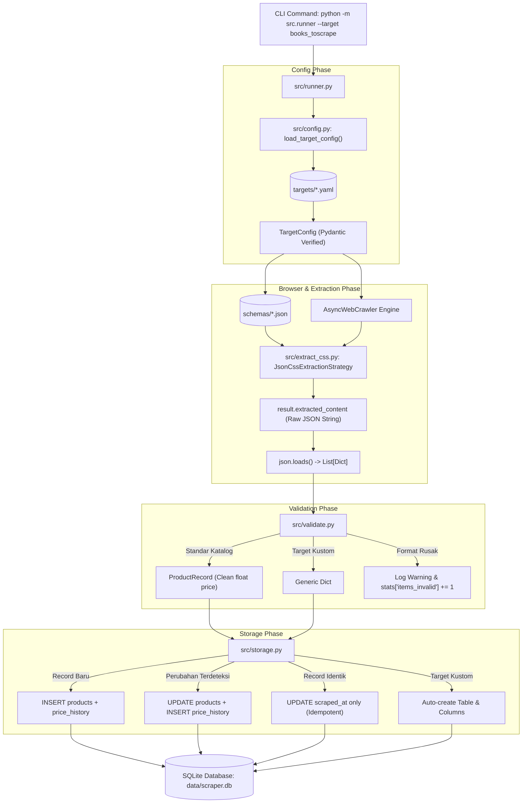
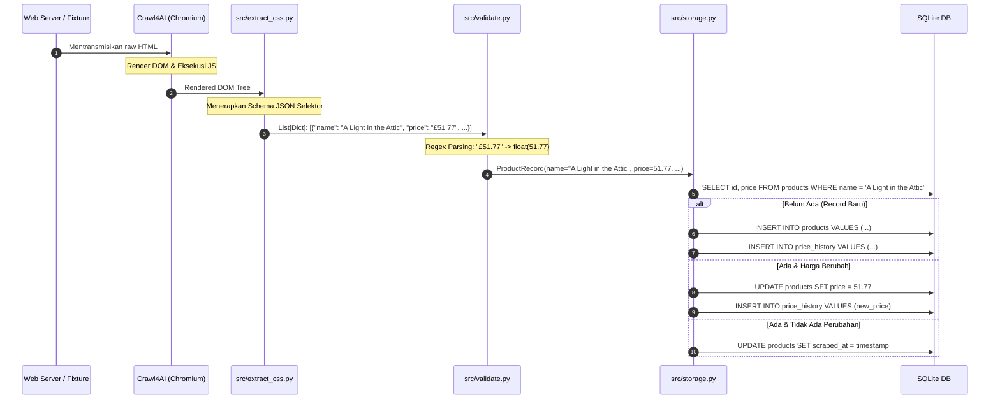

# 🕷️ Dokumentasi Teknis & Arsitektur Codebase Web Scraper (Crawl4AI)

> **Dokumentasi Teknis Sistem**: Penjelasan komprehensif mengenai arsitektur *config-driven*, peranan detail library Crawl4AI dalam sistem, aliran transformasi data di setiap stage (disertai contoh input-output konkret), hingga mekanisme penyimpanan idempotensi pada database SQLite.

---

## 📑 Daftar Isi
1. [Filosofi Arsitektur: Config-Driven Scraping](#1-filosofi-arsitektur-config-driven-scraping)
2. [Peta Struktur File & Direktori](#2-peta-struktur-file--direktori)
3. [Bedah File demi File (Deep Dive)](#3-bedah-file-demi-file-deep-dive)
   - [A. targets/*.yaml (Definisi Target)](#a-targetsyaml-definisi-target)
   - [B. schemas/*.json (Deklarasi Selektor)](#b-schemasjson-deklarasi-selektor)
   - [C. src/config.py (Validasi Konfigurasi Target)](#c-srcconfigpy-validasi-konfigurasi-target)
   - [D. src/extract_css.py (Integrasi Crawl4AI)](#d-srcextract_csspy-integrasi-crawl4ai)
   - [E. src/validate.py (Pembersihan & Validasi Tipe Data)](#e-srcvalidatepy-pembersihan--validasi-tipe-data)
   - [F. src/storage.py (Database, Idempotensi & Riwayat Harga)](#f-srcstoragepy-database-idempotensi--riwayat-harga)
   - [G. src/runner.py (CLI Orchestrator Pipeline)](#g-srcrunnerpy-cli-orchestrator-pipeline)
4. [Peranan Mendalam Crawl4AI & Transformasi Data Tiap Stage](#4-peranan-mendalam-crawl4ai--transformasi-data-tiap-stage)
   - [Stage 1: Lifecycle & Inisialisasi Engine Headless](#stage-1-lifecycle--inisialisasi-engine-headless)
   - [Stage 2: Navigasi, Evaluasi JavaScript & Rendering Halaman](#stage-2-navigasi-evaluasi-javascript--rendering-halaman)
   - [Stage 3: Ekstraksi Data Deklaratif (JsonCssExtractionStrategy)](#stage-3-ekstraksi-data-deklaratif-jsoncssextractionstrategy)
   - [Stage 4: Serialisasi Data Mentah & Parsing JSON](#stage-4-serialisasi-data-mentah--parsing-json)
   - [Stage 5: Pasca-Crawl4AI — Sanitasi & Pemodelan Data (Pydantic)](#stage-5-pasca-crawl4ai--sanitasi--pemodelan-data-pydantic)
   - [Stage 6: Pasca-Crawl4AI — Persistensi Idempotent & Price Tracking](#stage-6-pasca-crawl4ai--persistensi-idempotent--price-tracking)
5. [Diagram Arsitektur Workflow & Dataflow](#5-diagram-arsitektur-workflow--dataflow)
6. [Karakteristik & Fitur Unggulan Sistem](#6-karakteristik--fitur-unggulan-sistem)
7. [Panduan Operasional CLI & Verifikasi Database](#7-panduan-operasional-cli--verifikasi-database)
8. [Pengujian Otomatis Offline (Automated Testing)](#8-pengujian-otomatis-offline-automated-testing)

---

## 1. Filosofi Arsitektur: Config-Driven Scraping

Pada arsitektur scraper konvensional, URL website, selector CSS, pembersihan data, dan operasi database sering kali dicampur menjadi satu skrip monolitik:
```python
# ❌ Pendekatan Monolitik & Rawan Pecah
response = requests.get("https://contoh-toko.com")
soup = BeautifulSoup(response.text, "html.parser")
for item in soup.find_all("div", class_="card"):
    db.execute("INSERT INTO products VALUES (?)", (item.find("h2").text,))
```
Kelemahan pendekatan monolitik:
1. **Coupling Tinggi**: Menambah atau mengganti target website mengharuskan penulisan ulang skrip Python baru.
2. **Keterbatasan JavaScript**: Skrip HTTP client sederhana tidak mengeksekusi JavaScript/SPA sehingga gagal mengekstrak situs dinamis.
3. **Data Duplikat**: Tidak adanya penanganan idempotensi mengakibatkan data ganda saat dieksekusi berulang.
4. **Dependensi Jaringan pada Pengujian**: Unit test tidak dapat berjalan tanpa koneksi internet aktif.

### Solusi: Arsitektur Berbasis Konfigurasi (*Config-Driven*)
Codebase ini memisahkan secara tegas antara **mesin komputasi** dan **konfigurasi target**:
- **Mesin Universal (`src/`)**: Seluruh modul Python di direktori `src/` bersifat agnostik terhadap target. Mesin tidak mengetahui domain URL maupun nama class CSS spesifik dari website mana pun.
- **Konfigurasi Misi (`targets/*.yaml`)**: Menentukan URL target, mode ekstraksi, batasan laju (*rate limiting*), dan kuota halaman.
- **Aturan Ekstraksi (`schemas/*.json`)**: Menentukan pemetaan selektor CSS deklaratif untuk Crawl4AI.
- **Ekstraksi Asinkron Berbasis Browser**: Menggunakan headless Chromium (via Playwright) yang dikendalikan oleh Crawl4AI untuk me-render konten dinamis.
- **Sanitasi Ketat & Idempotensi**: Validasi tipe data menggunakan Pydantic serta penyimpanan pintar di SQLite yang mencegah duplikasi dan mencatat fluktuasi perubahan nilai data (misalnya riwayat harga).

---

## 2. Peta Struktur File & Direktori

```text
Crawl4AI/
├── targets/                      # 📁 Definisi target scraping (format YAML)
│   ├── _template.yaml            # Templat acuan target baru (diabaikan oleh loader)
│   ├── books_toscrape.yaml       # Target 1: Katalog Buku
│   ├── ecommerce_demo.yaml       # Target 2: Katalog Perangkat Laptop
│   └── job.yaml                  # Target 3: Lowongan Pekerjaan (Skema Dinamis)
│
├── schemas/                      # 📁 Aturan deklaratif ekstraksi CSS (format JSON)
│   ├── books_toscrape.json       # Selektor CSS untuk katalog buku
│   ├── ecommerce_demo.json       # Selektor CSS untuk katalog laptop
│   └── job.json                  # Selektor CSS untuk lowongan pekerjaan
│
├── src/                          # 📁 Mesin Inti Sistem (Agnostik Target)
│   ├── config.py                 # Parser & validator konfigurasi YAML (Pydantic)
│   ├── extract_css.py            # Adaptor Crawl4AI JsonCssExtractionStrategy
│   ├── validate.py               # Pembersih teks, regex parser, & validasi model
│   ├── storage.py                # Abstraksi database SQLite (idempotensi, riwayat, tabel dinamis)
│   └── runner.py                 # CLI entrypoint & async pipeline orchestrator
│
├── tests/                        # 📁 Test Suite Otomatis (100% Offline)
│   ├── fixtures/                 # Sampel file HTML mentah untuk isolasi tes
│   ├── test_m1.py                # Unit test fondasi, parsing, & storage
│   └── test_m2.py                # Integration test multi-target & idempotensi
│
├── data/                         # 📁 Direktori penyimpanan database SQLite (*.db)
├── requirements.txt              # Daftar dependensi Python teruji
├── PRD.md                        # Product Requirements Document
└── README.md                     # Dokumentasi petunjuk penggunaan
```

---

## 3. Bedah File demi File (Deep Dive)

### A. `targets/*.yaml` (Definisi Target)
File konfigurasi deklaratif yang berfungsi sebagai instruksi operasional untuk crawler.

**Contoh: [`targets/books_toscrape.yaml`](file:///d:/Fachrur%20Rizhky/Content/Web%20Scraper/Crawl4AI/targets/books_toscrape.yaml)**
```yaml
name: books_toscrape                                      # Identitas unik target
start_urls:
  - "https://books.toscrape.com/catalogue/page-1.html"    # Daftar URL awal
mode: css                                                 # Strategi ekstraksi ("css" atau "llm")
schema_file: schemas/books_toscrape.json                  # Rujukan path skema selektor
rate_limit_seconds: 1                                     # Interval jeda antar-request (detik)
scroll_full_page: false                                   # Flag pengguliran halaman penuh
max_pages: 1                                              # Batas kuota halaman yang diproses
```

---

### B. `schemas/*.json` (Deklarasi Selektor)
File skema yang dikonsumsi oleh `JsonCssExtractionStrategy` dari Crawl4AI untuk mengekstrak data dari DOM tanpa kode parsing manual.

**Contoh: [`schemas/books_toscrape.json`](file:///d:/Fachrur%20Rizhky/Content/Web%20Scraper/Crawl4AI/schemas/books_toscrape.json)**
```json
{
  "name": "books_toscrape_catalog",
  "baseSelector": "article.product_pod",
  "fields": [
    {
      "name": "name",
      "selector": "h3 a",
      "type": "attribute",
      "attribute": "title"
    },
    {
      "name": "price",
      "selector": "p.price_color",
      "type": "text"
    },
    {
      "name": "stock",
      "selector": "p.instock.availability",
      "type": "text"
    }
  ]
}
```
* **`baseSelector`**: Selektor pembungkus entitas berulang (satu kartu/baris item).
* **`fields`**: Atribut yang diekstrak dari dalam kontainer:
  - `type: "text"`: Mengambil representasi teks (`innerText`).
  - `type: "attribute"`: Mengambil nilai atribut HTML tertentu (misalnya atribut `title`, `href`, atau `src`).

---

### C. `src/config.py` (Validasi Konfigurasi Target)
Memastikan file konfigurasi YAML terverifikasi secara struktural sebelum eksekusi dimulai.

**Komponen Utama:**
- [`TargetConfig`](file:///d:/Fachrur%20Rizhky/Content/Web%20Scraper/Crawl4AI/src/config.py#L13-L30): Model Pydantic yang memvalidasi bahwa `rate_limit_seconds` bernilai $\ge 0$ dan `max_pages` bernilai $\ge 1$.
- `validate_mode_dependencies`: Validator logika internal. Jika konfigurasi menetapkan `mode = "css"`, modul mewajibkan kehadiran parameter `schema_file`.
- [`load_all_targets`](file:///d:/Fachrur%20Rizhky/Content/Web%20Scraper/Crawl4AI/src/config.py#L46-L58): Fungsi penemu target otomatis yang memindai direktori `targets/` dan mengabaikan file prefiks khusus seperti `_template.yaml`.

---

### D. `src/extract_css.py` (Integrasi Crawl4AI)
Modul antarmuka yang menghubungkan aplikasi dengan engine Crawl4AI.

**Komponen Utama:**
```python
strategy = JsonCssExtractionStrategy(schema=schema_dict)
run_config = CrawlerRunConfig(
    extraction_strategy=strategy,
    cache_mode=CacheMode.BYPASS,
    scan_full_page=scroll_full_page,
)
crawl_target = f"raw:{raw_html}" if raw_html is not None else url
result = await crawler.arun(url=crawl_target, config=run_config)
```
- [`load_schema`](file:///d:/Fachrur%20Rizhky/Content/Web%20Scraper/Crawl4AI/src/extract_css.py#L9-L15): Membaca dan mem-parse file JSON selektor.
- [`extract_with_css`](file:///d:/Fachrur%20Rizhky/Content/Web%20Scraper/Crawl4AI/src/extract_css.py#L17-L56): Mengirimkan URL dan strategi ekstraksi ke `crawler.arun()`. Mendukung protokol offline `raw:<html_content>` untuk pengujian tanpa internet.

---

### E. `src/validate.py` (Pembersihan & Validasi Tipe Data)
Modul transformasi data mentah menjadi objek terstruktur dengan tipe data yang terjamin.

**Komponen Utama:**
- [`ProductRecord`](file:///d:/Fachrur%20Rizhky/Content/Web%20Scraper/Crawl4AI/src/validate.py#L8-L43): Skema model untuk katalog standar.
- `clean_price`: Validator berbasis Regex (`r"(\d+(?:\.\d+)?)"`) yang mengekstrak angka desimal dari string harga kotor (misalnya `"£51.77"` $\rightarrow$ `51.77`).
- [`validate_generic`](file:///d:/Fachrur%20Rizhky/Content/Web%20Scraper/Crawl4AI/src/validate.py#L66-L98): Sanitizer dinamis untuk target berkonten non-produk (seperti lowongan kerja atau artikel berita).

---

### F. `src/storage.py` (Database, Idempotensi & Riwayat Harga)
Lapisan persistensi database SQLite (`data/scraper.db`) yang mendukung operasi atomik dan pelacakan audit data.

**Komponen Utama:**
1. **Idempotensi**: Menggunakan aturan integritas unik:
   $$\text{Unique Key} = (\text{target}, \text{source\_url}, \text{name})$$
   Jika record identik dikirim ulang, sistem menghasilkan status `"unchanged"` tanpa menulis duplikat.
2. **Pelacakan Riwayat Harga (*Price History Tracking*)**: Jika harga lama berbeda dengan harga baru ($\Delta > 0.0001$), tabel `products` diperbarui dan entri riwayat baru secara otomatis dicatat ke tabel `price_history`.
3. **Skema Tabel Dinamis ([`save_generic`](file:///d:/Fachrur%20Rizhky/Content/Web%20Scraper/Crawl4AI/src/storage.py#L211-L279))**: Membuat tabel baru secara dinamis serta menambahkan kolom baru via `ALTER TABLE ADD COLUMN` sesuai struktur field JSON yang ditemukan pada target kustom.

---

### G. `src/runner.py` (CLI Orchestrator Pipeline)
Orchestrator utama yang mengatur jalannya pipeline secara asinkron.

**Komponen Utama:**
- Antarmuka CLI berbasis `argparse` (`--target`, `--db`, `--fixture`, `--targets-dir`).
- Pengendali siklus hidup browser: membuka satu instance [`AsyncWebCrawler`](file:///d:/Fachrur%20Rizhky/Content/Web%20Scraper/Crawl4AI/src/runner.py#L158) untuk melayani seluruh antrean URL secara efisien.
- **Isolasi Kegagalan (*Fault Isolation*)**: Kesalahan atau kegagalan koneksi pada satu target tidak menghentikan eksekusi target lainnya.

---

## 4. Peranan Mendalam Crawl4AI & Transformasi Data Tiap Stage

Crawl4AI memegang peranan sebagai **mesin eksekusi inti (Execution Engine)** yang menangani seluruh kompleksitas browser level rendah (*low-level browser automation*). Berikut adalah rincian mendalam peran Crawl4AI di setiap tahap, dilengkapi data nyata transformasi input-output yang terjadi:

```
[Target URL / raw:HTML]
          │
          ▼  (Stage 1 & 2: Inisialisasi & Navigasi)
[Headless Chromium DOM Rendering]
          │
          ▼  (Stage 3: JsonCssExtractionStrategy)
[DOM Evaluation via Schema JSON]
          │
          ▼  (Stage 4: Serialization)
[Raw JSON String Output: result.extracted_content]
          │
          ▼  (Stage 5: Pydantic Validation & Sanitization)
[Strongly-typed Data Models: ProductRecord]
          │
          ▼  (Stage 6: SQLite Storage)
[Idempotent DB Insertion & Price History Tracking]
```

---

### Stage 1: Lifecycle & Inisialisasi Engine Headless
* **Modul**: [`src/runner.py`](file:///d:/Fachrur%20Rizhky/Content/Web%20Scraper/Crawl4AI/src/runner.py#L158) dan [`src/extract_css.py`](file:///d:/Fachrur%20Rizhky/Content/Web%20Scraper/Crawl4AI/src/extract_css.py#L34-L38)
* **Peran Crawl4AI**: 
  Menginisialisasi engine browser Chromium asinkron berbasis Playwright melalui *asynchronous context manager*. Menyiapkan parameter performa, mode cache (`CacheMode.BYPASS`), dan mekanisme *full page scanning*.
* **Data Masukan (Input)**:
  Objek konfigurasi runtime:
  ```python
  run_config = CrawlerRunConfig(
      extraction_strategy=strategy,
      cache_mode=CacheMode.BYPASS,
      scan_full_page=False,
  )
  ```
* **Hasil Keluaran (Output)**:
  Sesi browser aktif (`crawler: AsyncWebCrawler`) yang berjalan di latar belakang dan siap menerima perintah navigasi tanpa overhead inisialisasi berulang.

---

### Stage 2: Navigasi, Evaluasi JavaScript & Rendering Halaman
* **Modul**: [`src/extract_css.py`](file:///d:/Fachrur%20Rizhky/Content/Web%20Scraper/Crawl4AI/src/extract_css.py#L41)
* **Peran Crawl4AI**:
  Melakukan *network request* ke URL target, memuat seluruh aset dokumen, mengeksekusi skrip JavaScript di sisi klien, menangani DOM dinamis, serta mengonstruksi *rendered DOM tree* utuh pada memori browser.
* **Data Masukan (Input)**:
  String URL target:
  ```text
  "https://books.toscrape.com/catalogue/page-1.html"
  ```
* **Hasil Keluaran (Output)**:
  DOM Tree yang ter-render sempurna di dalam engine Chromium, memuat representasi HTML terstruktur:
  ```html
  <article class="product_pod">
    <div class="image_container">
      <a href="a-light-in-the-attic_1000/index.html">
        
      </a>
    </div>
    <h3>
      <a href="a-light-in-the-attic_1000/index.html" title="A Light in the Attic">A Light in the ...</a>
    </h3>
    <div class="product_price">
      <p class="price_color">£51.77</p>
      <p class="instock availability">
        <i class="icon-ok"></i> In stock
      </p>
    </div>
  </article>
  ```

---

### Stage 3: Ekstraksi Data Deklaratif (`JsonCssExtractionStrategy`)
* **Modul**: [`src/extract_css.py`](file:///d:/Fachrur%20Rizhky/Content/Web%20Scraper/Crawl4AI/src/extract_css.py#L33)
* **Peran Crawl4AI**:
  Menerjemahkan aturan selektor dari file skema JSON menjadi kode evaluasi DOM internal di dalam browser. Crawl4AI menemukan seluruh kontainer yang sesuai dengan `baseSelector`, mengisolasi lingkup pencarian ke kontainer tersebut, lalu mengekstrak nilai bidang-bidang yang diminta (`text` atau atribut spesifik).
* **Data Masukan (Input)**:
  1. DOM Tree hasil render dari Stage 2.
  2. Kamus skema selektor (dari [`schemas/books_toscrape.json`](file:///d:/Fachrur%20Rizhky/Content/Web%20Scraper/Crawl4AI/schemas/books_toscrape.json)):
     ```json
     {
       "name": "books_toscrape_catalog",
       "baseSelector": "article.product_pod",
       "fields": [
         {"name": "name", "selector": "h3 a", "type": "attribute", "attribute": "title"},
         {"name": "price", "selector": "p.price_color", "type": "text"},
         {"name": "stock", "selector": "p.instock.availability", "type": "text"}
       ]
     }
     ```
* **Proses yang Terjadi di Browser**:
  1. Mengumpulkan semua node `article.product_pod` (menemukan 20 elemen kartu buku).
  2. Pada setiap elemen:
     - Mencari `h3 a`, membaca nilai atribut `title` $\rightarrow$ `"A Light in the Attic"`
     - Mencari `p.price_color`, membaca teks node $\rightarrow$ `"£51.77"`
     - Mencari `p.instock.availability`, membaca teks node $\rightarrow$ `"\n    \n        In stock\n    \n"`
* **Hasil Keluaran (Output)**:
  Koleksi data terstruktur in-memory di dalam browser sebelum serialisasi.

---

### Stage 4: Serialisasi Data Mentah & Parsing JSON
* **Modul**: [`src/extract_css.py`](file:///d:/Fachrur%20Rizhky/Content/Web%20Scraper/Crawl4AI/src/extract_css.py#L43-L53)
* **Peran Crawl4AI**:
  Mengonversi kumpulan data elemen dari konteks browser menjadi string JSON valid dan membungkusnya ke dalam objek hasil crawling (`CrawlResult.extracted_content`) lengkap dengan indikator keberhasilan (`CrawlResult.success`).
* **Data Masukan (Input)**:
  Node data hasil evaluasi dari Stage 3.
* **Hasil Keluaran (Output)**:
  1. Properti `result.extracted_content` bertipe string:
     ```json
     "[{\"name\": \"A Light in the Attic\", \"price\": \"£51.77\", \"stock\": \"In stock\"}, {\"name\": \"Tipping the Velvet\", \"price\": \"£53.74\", \"stock\": \"In stock\"}]"
     ```
  2. Setelah diparsing melalui `json.loads(extracted_raw)` di baris 48:
     ```python
     [
         {
             "name": "A Light in the Attic",
             "price": "£51.77",
             "stock": "In stock",
         },
         {
             "name": "Tipping the Velvet",
             "price": "£53.74",
             "stock": "In stock",
         },
     ]
     ```

---

### Stage 5: Pasca-Crawl4AI — Sanitasi & Pemodelan Data (Pydantic)
* **Modul**: [`src/validate.py`](file:///d:/Fachrur%20Rizhky/Content/Web%20Scraper/Crawl4AI/src/validate.py#L44-L64)
* **Peran Sistem**:
  Data mentah keluaran Crawl4AI masih berupa string dengan simbol mata uang (`£`) dan spasi berlebih. Lapisan validasi membersihkan nilai-nilai ini dan menetapkan tipe data baku.
* **Data Masukan (Input)**:
  Satu dictionary mentah dari Stage 4:
  ```python
  {"name": "A Light in the Attic", "price": "£51.77", "stock": "In stock"}
  ```
* **Proses Transformasi**:
  1. `clean_name`: Menghilangkan whitespace di awal/akhir dan memastikan nilai tidak kosong.
  2. `clean_price`: Menjalankan regex `r"(\d+(?:\.\d+)?)"` pada `"£51.77"` $\rightarrow$ menghasilkan nilai numerik `51.77` bertipe `float`.
  3. Menyuntikkan metadata konteks (`target`, `source_url`, `scraped_at`).
* **Hasil Keluaran (Output)**:
  Instance model data [`ProductRecord`](file:///d:/Fachrur%20Rizhky/Content/Web%20Scraper/Crawl4AI/src/validate.py#L8-L43):
  ```python
  ProductRecord(
      target="books_toscrape",
      source_url="https://books.toscrape.com/catalogue/page-1.html",
      name="A Light in the Attic",
      price=51.77,
      stock="In stock",
      scraped_at=datetime.datetime(2026, 11, 11, 13, 26, 0, tzinfo=timezone.utc),
  )
  ```

---

### Stage 6: Pasca-Crawl4AI — Persistensi Idempotent & Price Tracking
* **Modul**: [`src/storage.py`](file:///d:/Fachrur%20Rizhky/Content/Web%20Scraper/Crawl4AI/src/storage.py#L51-L132)
* **Peran Sistem**:
  Menerapkan aturan idempotensi dan audit fluktuasi harga ke database SQLite.
* **Data Masukan (Input)**:
  Objek `ProductRecord` dari Stage 5.
* **Logika Penyimpanan**:
  1. Memeriksa keberadaan data lama melalui query kunci unik:
     ```sql
     SELECT id, price, stock FROM products WHERE target = ? AND source_url = ? AND name = ?;
     ```
  2. Jika data baru $\rightarrow$ `action = "inserted"`.
  3. Jika data sudah ada dan harga berubah $\rightarrow$ `action = "updated"`, perbarui tabel `products` dan sisipkan baris baru ke `price_history`.
  4. Jika data identik $\rightarrow$ `action = "unchanged"`, hanya perbarui timestamp `scraped_at`.
* **Hasil Keluaran (Output) pada SQLite (`data/scraper.db`)**:
  
  **Tabel `products`:**
  | id | target | source_url | name | price | stock | scraped_at |
  | :--- | :--- | :--- | :--- | :--- | :--- | :--- |
  | `1` | `books_toscrape` | `https://books.toscrape.com/...` | `A Light in the Attic` | `51.77` | `In stock` | `2026-11-11T13:26:00` |

  **Tabel `price_history`:**
  | id | product_id | price | stock | recorded_at |
  | :--- | :--- | :--- | :--- | :--- |
  | `1` | `1` | `51.77` | `In stock` | `2026-11-11T13:26:00` |

---

## 5. Diagram Arsitektur Workflow & Dataflow

### Diagram Alur Eksekusi (Architecture Workflow)


### Diagram Transformasi Data Nyata (Sequence Dataflow)


---

## 6. Karakteristik & Fitur Unggulan Sistem

1. **Skalabilitas Tanpa Modifikasi Kode (*Zero-Code Extension*)**:
   Menambah situs target baru hanya membutuhkan penambahan 1 file konfigurasi YAML pada direktori `targets/` dan 1 file skema selektor pada direktori `schemas/`. Modul pada `src/` tidak perlu diubah.
2. **Kinerja Asinkron Berbasis Playwright**:
   Crawl4AI mengontrol browser melalui arsitektur asynchronous `asyncio`. Hal ini memberikan efisiensi resource yang jauh lebih tinggi dibanding otomasi berbasis thread/Selenium konvensional.
3. **Pembersihan dan Validasi Data Terpusat**:
   Nilai-nilai string kotor (seperti simbol mata uang, label status stok bertingkat, dan whitespace) dibersihkan secara otomatis menggunakan validator Pydantic dan regex.
4. **Idempotensi & Pelacakan Audit Nilai**:
   Pipeline dapat dijalankan berulang tanpa risiko duplikasi baris. Perubahan harga pada produk yang sama otomatis terekam dalam tabel `price_history`.
5. **Skema Tabel Dinamis untuk Ragam Data**:
   Mendukung penyimpanan data arbitrer (misalnya lowongan pekerjaan, artikel, atau listing properti) yang otomatis membuat tabel baru dan kolom baru sesuai field yang diekstrak.
6. **Kemampuan Pengujian 100% Offline**:
   Memanfaatkan dukungan Crawl4AI untuk string HTML dengan format `raw:<html_content>`, memungkinkan unit test dan integration test berjalan tanpa dependensi koneksi internet.

---

## 7. Panduan Operasional CLI & Verifikasi Database

### A. Perintah Eksekusi CLI

```powershell
# 1. Menjalankan target spesifik (Books to Scrape)
python -m src.runner --target books_toscrape

# 2. Menjalankan target ecommerce demo
python -m src.runner --target ecommerce_demo

# 3. Menjalankan target dengan output database kustom
python -m src.runner --target job --db data/job.db

# 4. Menjalankan dalam mode pengujian offline menggunakan file fixture
python -m src.runner --target ecommerce_demo --fixture tests/fixtures/ecommerce_demo.html

# 5. Menjalankan seluruh target yang terdaftar di direktori targets/
python -m src.runner
```

---

### B. Perintah Verifikasi Hasil pada Database SQLite

Berikut kumpulan one-liner Python untuk memeriksa isi database langsung dari terminal:

```powershell
# 1. Menampilkan daftar tabel yang ada di dalam database
python -c "import sqlite3; conn = sqlite3.connect('data/scraper.db'); print('Daftar Tabel:', [r[0] for r in conn.execute(\"SELECT name FROM sqlite_master WHERE type='table' AND name NOT LIKE 'sqlite_%'\").fetchall()])"

# 2. Menampilkan 5 record produk teratas dalam format JSON rapi
python -c "import sqlite3, json; conn = sqlite3.connect('data/scraper.db'); conn.row_factory = sqlite3.Row; print(json.dumps([dict(r) for r in conn.execute('SELECT target, name, price, stock FROM products LIMIT 5')], indent=2))"

# 3. Memeriksa catatan riwayat fluktuasi harga (price_history)
python -c "import sqlite3, json; conn = sqlite3.connect('data/scraper.db'); conn.row_factory = sqlite3.Row; print(json.dumps([dict(r) for r in conn.execute('SELECT * FROM price_history LIMIT 5')], indent=2))"

# 4. Menampilkan record dari tabel dinamis (misalnya tabel job pada data/job.db)
python -c "import sqlite3, json; conn = sqlite3.connect('data/job.db'); conn.row_factory = sqlite3.Row; print(json.dumps([dict(r) for r in conn.execute('SELECT job_name, company, location FROM job LIMIT 5')], indent=2))"

# 5. Menampilkan total jumlah baris data
python -c "import sqlite3; conn = sqlite3.connect('data/scraper.db'); print('Total Produk:', conn.execute('SELECT COUNT(*) FROM products').fetchone()[0])"
```

---

## 8. Pengujian Otomatis Offline (Automated Testing)

Seluruh test suite dirancang untuk dapat dijalankan secara terisolasi tanpa memerlukan akses internet, memanfaatkan sampel HTML lokal di `tests/fixtures/`:

```powershell
# Menggunakan virtual environment aktif
.\.venv\Scripts\python.exe -m pytest -v
```

Hasil eksekusi test suite memvalidasi:
- Kemampuan pembacaan dan parsing konfigurasi YAML ([`test_m1.py`](file:///d:/Fachrur%20Rizhky/Content/Web%20Scraper/Crawl4AI/tests/test_m1.py)).
- Ketahanan regex pembersihan data pada Pydantic model.
- Integritas idempotensi dan pencatatan riwayat harga pada SQLite.
- Ekstraksi multi-layout dengan skema data seragam ([`test_m2.py`](file:///d:/Fachrur%20Rizhky/Content/Web%20Scraper/Crawl4AI/tests/test_m2.py)).
- Isolasi kegagalan (*fault tolerance*) saat satu target mengalami kegagalan.

---
*Dokumentasi ini menjadi referensi teknis arsitektur sistem web scraper berbasis Crawl4AI.*
